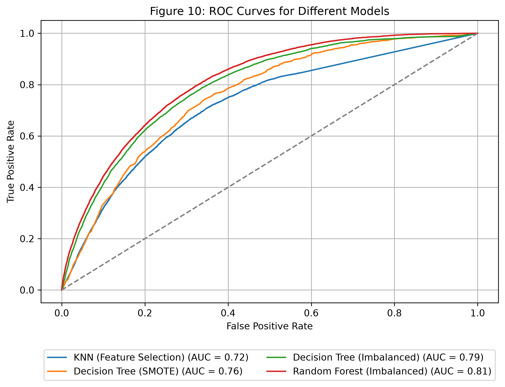

## Introduction {.center}

In healthcare, kNN has shown promise in predicting chronic diseases like
**diabetes** [@suriya2023type] and **hypertension** [@khateeb2017efficient].

In this project, we focus on how kNN can be applied and optimized to
predict **diabetes**, a critical and growing public health issue.

::: notes
kNN is a well-known algorithm that’s already been applied in medical research, including disease prediction for conditions like hypertension and diabetes.
In this project, we explored how kNN behaves with health data and how we can optimize it to improve predictive accuracy for diabetes.
:::

## Why This Matters {.center}

<span class="fragment">- Diabetes affects millions worldwide. Early
detection can improve outcomes.

<span class="fragment">- Machine learning, especially interpretable
models like **kNN**, can support diagnosis.

<span class="fragment">- Our project explores:

<span class="fragment">- How different **k values**, **distance metrics**, and
    **preprocessing techniques** affect kNN’s performance.
    
<span class="fragment">- Whether kNN is competitive with other models for this task.

::: notes
Diabetes affects over 37 million people in the U.S., and many don’t know they have it. Early detection is critical to avoid complications.
Machine learning can help — especially models like kNN that are easy to understand and implement.
We tested how different settings, such as the number of neighbors, distance metrics, and preprocessing techniques impact performance.
We also compared kNN with models like decision trees and random forests to see how it holds up.
:::

## Why We Chose kNN for This Project

<span class="fragment">Well-suited for medical datasets with small to
medium size

<span class="fragment">Easy to interpret — great for health
professionals

<span class="fragment">Flexible with minimal assumptions

<span class="fragment">Can impute missing data and detect patterns

::: notes
We chose kNN because it’s simple, interpretable, and works well on structured health data like surveys.
Unlike more complex models, kNN doesn’t make strong assumptions — it just compares similar cases.
That makes it more transparent, which is valuable in healthcare, where decision-making needs to be explainable.
:::

## Our Approach {.center}

-   Clean and preprocess real-world survey data.
-   Train kNN models with various configurations.
-   Evaluate performance and compare with tree-based models.

::: notes
Our project followed a structured approach.
We used the CDC’s diabetes health indicators dataset, which includes over 250,000 survey responses.
After cleaning and preparing the data, we trained multiple versions of kNN by changing key parameters like the number of neighbors and the distance metric.
We then compared kNN 4 (SMOTE + feature selection) with decision trees and random forests to see how it performed in a real-world healthcare prediction task.
:::

## Method: kNN Overview {.center .middle}


<span class="fragment">k-Nearest Neighbors (kNN) is a **non-parametric, instance-based** learning algorithm</span>

<span class="fragment">It is a **lazy learner** — no explicit training phase is required</span>

<span class="fragment">Instead, it classifies new data based on similarity to existing labeled points [@zhang2016introduction]</span>

---

### <span class="fragment">Classification Process:</span>

<span class="fragment">**1. Distance Calculation:**  
Measures similarity using metrics like **Euclidean** or **Manhattan** distance</span>

<span class="fragment">**2. Neighbor Selection:**  
Hyperparameter **k** defines how many nearby points to consider</span>

<span class="fragment">**3. Majority Voting:**  
The most frequent class among the **k nearest neighbors** determines the prediction</span>

::: notes
So, let’s talk about how kNN actually works
kNN is known as a lazy learner - it doesn’t train a model in advance. Instead, it stores all the data and makes predictions based on similarity.
When a new data point comes in, kNN finds the closest examples from the training set - based on distance -  and predicts the most common label among them.
This makes it intuitive and highly adaptable, which is why it’s useful in clinical applications where transparency matters.

The process starts by calculating the distance - we used both Euclidean and Manhattan distances in our tests.
Then, the model looks at the closest k data points — and this k is something we tune to get better results.
Finally, it uses majority voting: whichever class appears most often among the neighbors becomes the prediction.
:::

## Distance Calculation: {.smaller}

kNN identifies the nearest neighbors by calculating distances between points.

<div class="fragment">

**Euclidean distance:**  [@theerthagiri2022diagnosis]
$$
d = \sqrt{(X_2 - X_1)^2 + (Y_2 - Y_1)^2}
$$

</div>

<div class="fragment">

**Manhattan distance:** [@aggarwal2015data] 
$$
d = |X_2 - X_1| + |Y_2 - Y_1|
$$

</div>

::: {style="text-align: center; margin-top: 1em;"}
```{r}
library(ggplot2)

# Add points
X1 <- 10; Y1 <- 12
X2 <- 14; Y2 <- 16

# Create base plot
plot(c(X1, X2), c(Y1, Y2), type = "n",
     xlab = "X-axis", ylab = "Y-axis",
     main = "Figure 2: Euclidean and Manhattan Distances",
     xlim = c(X1 - 4, X2 + 4), ylim = c(Y1 - 4, Y2 + 4))

# Plot points
points(X1, Y1, col = "red", pch = 16, cex = 2) 
points(X2, Y2, col = "blue", pch = 16, cex = 2)

# Add Manhattan path (green arrows)
arrows(X1, Y1, X2, Y1, col = "darkgreen", lwd = 2, length = 0.1)  # horizontal
arrows(X2, Y1, X2, Y2, col = "darkgreen", lwd = 2, length = 0.1)  # vertical

# Add Euclidean line (dashed purple)
segments(X1, Y1, X2, Y2, col = "purple", lwd = 2, lty = 2)

# Point labels
text(X1 - 0.5, Y1, labels = paste("(X1, Y1)\n(", X1, ",", Y1, ")"),
     col = "red", cex = 0.8, pos = 2)
text(X2 + 0.5, Y2, labels = paste("(X2, Y2)\n(", X2, ",", Y2, ")"),
     col = "blue", cex = 0.8, pos = 4)

# Euclidean distance label + arrow
text((X1 + X2)/2 - 1, (Y1 + Y2)/2 + 2.5, "Euclidean Distance (d)", col = "purple", font = 2, cex = 1)
arrows((X1 + X2)/2, (Y1 + Y2)/2 + 2, (X1 + X2)/2, (Y1 + Y2)/2 + 0.6,
       col = "purple", lwd = 1.5, length = 0.1)

# Manhattan label
text(X2 + 1.5, Y1 + 0.5, "Manhattan\nDistance", col = "darkgreen", font = 2, cex = 0.9, pos = 4)

# Euclidean distance formula
text(mean(c(X1, X2)), mean(c(Y1, Y2)) - 4.5, 
     labels = expression(d == sqrt((14 - 10)^2 + (16 - 12)^2)), 
     col = "black", cex = 0.9)

```
:::

::: notes
To find “closeness,” kNN uses distance metrics.
We tested two types: The most common is Euclidean distance, which measures straight-line distance, and Manhattan distance, which works like a city grid.
Since kNN relies on distance, the choice of metric — along with scaling — can significantly affect results.
This diagram shows both — we tested both in our project to compare results.
:::

## Classification Process {.center .middle}

::::: columns
::: {.column width="50%"}
<span class="fragment">The red square represents a data point to be
classified. The algorithm selects the 5 nearest neighbors within the
green circle—3 hearts and 2 circles. Based on the majority vote, the red
square is classified as a heart.
:::

::: {.column width="40%"}

:::
:::::

::: notes
Here’s a simple example of how kNN makes a prediction.
The red square is a new point. It looks at the 5 nearest neighbors — in this case, 3 hearts and 2 circles.
Since hearts are the majority, the red square is predicted as a heart.
This simple majority voting process makes kNN easy to understand and explain - a big advantage in medical settings.
:::

## Strengths and Weaknesses of kNN {.smaller}

::::: columns
::: {.column width="50%"}
### Strengths

- **Simple, intuitive, and non-parametric** — no assumptions about data distribution  
- **No training phase** — the algorithm learns during prediction  
- **Performs well** on small to medium datasets, especially when features are well-scaled  
- **Easy to understand and implement** — ideal for baseline models or educational use
:::

::: {.column width="50%"}

### Weaknesses of kNN 

- **Slow prediction time** on large datasets due to distance calculations [@deng2016efficient] 
- **Sensitive to feature scaling and distance metric choice** [@uddin2022comparative] 
- **Choosing the right 'k'** is critical — too low or high can reduce performance  
- **Affected by irrelevant or correlated features**, which may distort neighbor similarity

:::
:::::

::: notes
Here’s a quick summary of what makes kNN useful, and what challenges come with it.
It’s simple, doesn’t need training, and works well with smaller datasets when features are properly scaled. That’s why it’s often used for quick testing or in educational settings.
But it can struggle with large datasets or noisy features. It’s also sensitive to scaling, and choosing the right k value is really important.
That’s why preprocessing and tuning are so important - especially in healthcare, where accuracy and fairness matter.
:::

## Analysis and Results 

### Data Source and Collection {.smaller}

**Data Source:** [CDC Diabetes Health
Indicators](https://archive.ics.uci.edu/dataset/891/cdc+diabetes+health+indicators.) 

Collected via the CDC’s Behavioral Risk Factor Surveillance System
(BRFSS)

Dataset contains 253,680 survey responses

Covers 21 features: demographics, lifestyle, healthcare, and health
history

**Target:** Diabetes_binary

(0 = No diabetes, 1 = Diabetes/Prediabetes)

::: notes
For this project, we used real survey data from the CDC’s BRFSS program.
The dataset includes over 250,000 adult responses and covers a wide range of features like age, BMI, physical activity, and general health.
Our target was a binary variable indicating diabetes or prediabetes.
The dataset’s size and feature variety made it an ideal test case for evaluating how kNN behaves in a real-world health context.
:::

## Data Challenges {.smaller}

**Data Quality**  
[No missing values]{.fragment}  
[24,206 duplicate rows detected]{.fragment}

**Outliers & Scaling Sensitivity**  
[BMI, MentHlth, PhysHlth had extreme values]{.fragment}  
[kNN is highly sensitive to scale]{.fragment}

**Feature Relationships**  
[No strong multicollinearity (max r = 0.52)]{.fragment}  
[All features retained for now]{.fragment}

**Early Insight**  
[Higher BMI in diabetic cases, but overlapping range]{.fragment}  
[Used as a predictor along with other features]{.fragment}

::: notes
Before modeling, we looked closely at the raw dataset.
There were no missing values, but nearly 10% of the data was duplicated - those could bias the model if not removed.
BMI and other health features showed outliers, and because kNN uses distance, that’s a problem - large values can dominate.
We also checked for correlation but didn’t find any features that were too closely related.
One early pattern we noticed: people with diabetes generally had higher BMI, but it wasn’t only factor.
:::

## Class Distribution: {.smaller}
### Diabetes Class Imbalance {.smaller}

::::: columns
::: {.column width="50%"}
**Key Points**\
[Significant class imbalance observed]{.fragment}\
[Majority class: No Diabetes (0) – **86.07%**]{.fragment}\
[Minority class: Diabetes (1) – **13.93%**]{.fragment}

**Impact on Modeling**\
[Imbalance can bias predictions]{.fragment}\
[Models may underpredict diabetes cases]{.fragment}
:::

::: {.column width="40%"}
```{r setup, include=FALSE}
library(reticulate)
use_python(Sys.which("python3"), required = TRUE)

```

```{python, echo=FALSE, results='hide', message=FALSE, warning=FALSE}
import pandas as pd
import matplotlib.pyplot as plt
import seaborn as sns

# Real values
class_counts = pd.Series({0: 218334, 1: 35346})
class_percentages = class_counts / class_counts.sum() * 100

# Plot
plt.figure(figsize=(9, 6))
ax = sns.barplot(x=class_counts.index, y=class_counts.values, palette=["#66c2a5", "#fc8d62"])

# Smaller annotation text inside bars
for i, value in enumerate(class_counts.values):
    percentage = class_percentages[i]
    ax.text(i, value - 15000, f"{value:,}\n({percentage:.2f}%)", 
            ha="center", va="top", fontsize=10, fontweight='bold', color="white")

# Title and axes
plt.title("Figure 5: Class Distribution of Diabetes_binary", fontsize=16, fontweight='bold', pad=20)
plt.ylabel("Count")
plt.xlabel("Diabetes Status (0 = No, 1 = Diabetes/Prediabetes)")
plt.xticks([0, 1], ["No Diabetes", "Diabetes/Prediabetes"])
plt.ylim(0, max(class_counts.values) + 25000)

plt.tight_layout()
plt.show()

```

:::
:::::

::: notes
Another major challenge was class imbalance.
About 86% of cases were non-diabetic, and only 14% were diabetic or prediabetic.
This imbalance can cause models to favor the majority class and miss early diabetes cases.
We addressed this in preprocessing.
:::

## Preparing the Data {.smaller}

-   **Removed 24,206 duplicate rows**\
    [Diabetic class increased from 13.9% → 15.3%]{.fragment}

-   **Kept ordinal features as numeric**\
    [Age, Education, Income, and GenHlth retained due to natural ordering]{.fragment}

-   **Scaled Features with Outliers**\
    [Features scaled with StandardScaler or RobustScaler (fitted on training data)]{.fragment}

-   **Handled class imbalance**\
    [Applied SMOTE to generate synthetic diabetic samples]{.fragment}

➡️ Final dataset: **clean and scaled; SMOTE applied to training data only**

::: notes
To get the data ready, we removed duplicates and kept ordinal features like age, education, and income as numeric.
Features were scaled with StandardScaler or RobustScaler, fitted on the training data, to ensure equal contribution during distance calculations, a critical aspect for kNN’s accuracy.
To fix the class imbalance, we used SMOTE, which creates synthetic diabetic cases to help the model learn both classes equally.
After these steps, the data was cleaned and scaled, and SMOTE balanced the training set for kNN 3 and kNN 4.
:::

## kNN Model Setup {.smaller}

-   Explored different **k values**: 5, 10, 15\
-   Compared **distance metrics**: Euclidean vs. Manhattan\
-   Evaluated **weighting methods**: uniform vs. distance\
-   Tested multiple **scaling techniques**\
-   Included variations with **SMOTE** and **Feature Selection**

::: {style="overflow-x: auto; font-size: 90%"}
| Model | k   | Distance        | Weights  | Scaler         | SMOTE                   |
|------------|------------|------------|------------|------------|------------|
| kNN 1 | 5   | Euclidean (p=2) | Uniform  | StandardScaler | No                      |
| kNN 2 | 15  | Manhattan (p=1) | Distance | RobustScaler   | No                      |
| kNN 3 | 10  | Euclidean (p=2) | Uniform  | StandardScaler | Yes                     |
| kNN 4 | 15  | Euclidean (p=2) | Distance | StandardScaler | Yes (Feature Selection) |
:::

::: notes
To better understand kNN’s behavior, we designed four model variations.
We changed the number of neighbors, distance type, and weighting method.
We also experimented with different scaling techniques and applied SMOTE to handle class imbalance.
In one version, we also used feature selection to reduce dimensional noise.
kNN 4 combined SMOTE with chi-square feature selection.
:::

## Performance of kNN Variants {.smaller}
#### Table 4: Performance Comparison of kNN Models {.no-title}

::: {style="overflow-x: auto; font-size: 90%"}
| Model | k | Distance | Weights | Scaler | SMOTE | Accuracy | ROC_AUC | PR_AUC | Precision_1 | Recall_1 | F1_1 |
|-------|-------|-------|-------|-------|-------|-------|-------|-------|-------|-------|-------|
| kNN 1 | 5 | Euclidean (p=2) | Uniform | StandardScaler | No | 0.832 | 0.705 | 0.281 | 0.406 | 0.206 | 0.274 |
| kNN 2 | 15 | Manhattan (p=1) | Distance | RobustScaler | No | 0.841 | **0.752** | **0.334** | 0.446 | 0.155 | 0.230 |
| kNN 3 | 10 | Euclidean (p=2) | Uniform | StandardScaler | Yes | 0.691 | 0.733 | 0.286 | 0.278 | **0.641** | 0.388 |
| kNN 4 | 15 | Euclidean (p=2) | Distance | StandardScaler | Yes (FS) | 0.731 | 0.722 | 0.300 | 0.303 | 0.579 | **0.397** |
:::

- **Best ROC-AUC among kNN: kNN 2** (0.752)  
  [RobustScaler, Manhattan distance, distance weighting]{.fragment}

- **SMOTE raised recall** from ~0.2 to 0.58–0.64  
  [at the cost of lower precision]{.fragment}

- Feature selection (kNN 4): 12 features instead of 21, mixed results vs. kNN 3

::: notes
Table 4 shows the results for each kNN model.
As you can see, model performance varies significantly depending on configuration. For instance, KNN 1 and 2 without SMOTE had higher accuracy but poor recall - meaning they missed a lot of diabetic cases.
kNN 2 had the best ROC-AUC among kNN models. SMOTE in kNN 3 and kNN 4 tripled recall for diabetic cases, but lowered precision.
Feature selection in kNN 4 reduced the features from 21 to 12 with mixed results. We use kNN 4 for the comparison with tree models because, among the configurations that detect most diabetic cases, it had the best balance between precision and recall (highest F1, 0.397).
:::

## Comparing kNN with Tree Models {.smaller}
 
#### Table 5: kNN 4 vs. Tree-Based Models {.no-title}

::: {style="overflow-x: auto; font-size: 90%"}
| Model         | SMOTE | Accuracy | ROC_AUC | PR_AUC | Precision_1 | Recall_1 | F1_1 |
|---------------|-------|----------|---------|--------|-------------|----------|------|
| KNN 4         | Yes   | 0.731    | 0.722   | 0.300  | 0.303       | 0.579    | 0.397 |
| Decision Tree | Yes   | 0.671    | 0.756   | 0.317  | 0.281       | **0.740** | **0.407** |
| Decision Tree | No    | 0.849    | 0.794   | 0.388  | 0.517       | 0.154    | 0.237 |
| Random Forest | No    | **0.854** | **0.813** | **0.432** | 0.599  | 0.134    | 0.219 |
:::


<span class="fragment">- **Random Forest had the best ROC-AUC (0.813)
and PR-AUC (0.432)**\

<span class="fragment">- **Decision Tree with SMOTE** had the highest
recall (0.740) and F1 (0.407)\

<span class="fragment">- **Random Forest had highest accuracy**, but
**poor recall** (0.13) shows it struggled to detect diabetic cases\

Tree-based models offer interpretability, but
may need tuning or resampling for minority detection

::: notes
We also compared kNN 4 to Decision Trees and Random Forests.
Random Forest had the highest accuracy and the best ROC-AUC — but at the 0.5 threshold it missed most diabetic cases.
The Decision Tree with SMOTE had the highest recall.
kNN 4 did not reach the performance of the tree-based models.
:::

## ROC_AUC curves comparison {.smaller}

ROC curves of kNN 4 and the tree-based models on the same test set.\
Random Forest has the highest AUC (0.81), kNN 4 reaches 0.72.



::: notes
This ROC curve shows how well each model separates diabetic from non-diabetic cases.
Random Forest had the highest AUC of 0.81, followed by the Decision Tree.
kNN 4 reached an AUC of 0.72.
After correcting data leakage in the evaluation, kNN did not outperform the tree-based models.
:::

## Conclusion {.smaller}

- Preprocessing changes kNN's behavior: configurations with **SMOTE** had ~3× higher recall for diabetic cases (~0.6 vs. ~0.2); **RobustScaler, Manhattan distance, k = 15 and distance weighting** (kNN 2) improved ROC-AUC (0.70 → 0.75).\

- On this large dataset, **tree-based models achieved higher ROC-AUC**: Random Forest had the best ROC-AUC (0.813), Decision Tree with SMOTE the highest recall (0.740).\

- **No single best model:** the choice of model and metric should follow the goal of the analysis.\

- **Accuracy alone is misleading** for imbalanced medical data.\

- *Revision 2026:* the original evaluation of kNN 4 (AUC 0.88) contained data leakage; all models were re-evaluated on one untouched test set.\

::: notes
In conclusion, preprocessing choices clearly change how kNN performs, and the configurations with SMOTE detected far more diabetic cases.
However, after correcting the evaluation, tree-based models - especially Random Forest - performed better than kNN on this dataset.
The original result of AUC 0.88 was inflated by data leakage; the corrected results provide a valid estimate of performance.
:::

## References {.smaller .scrollable}


